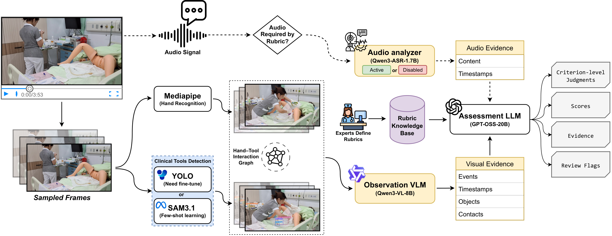

# SkilLens

SkilLens is a research framework for rubric-based assessment of clinical skills videos. It separates visual observation from criterion-level scoring, keeps timestamped evidence, and exports a reviewable assessment. The bundled assessment models are **configuration defaults**, not included weights or hosted services.

[](docs/SkilLens-Framework.pdf)

*Conceptual framework overview. Click the image for the vector PDF. The figure includes optional perception and audio modules. Its Qwen3-ASR audio label is illustrative; `.env.example` currently uses `gpt-4o-mini-transcribe` unless you configure another transcription endpoint.*

```text
Video + exam rubric
       │
       ├─ optional YOLO / SAM 3.1 perception, or detector-free time windows
       ↓
Qwen3-VL-8B-Instruct (visual observation)
       ↓ timestamped evidence
GPT-OSS-20B (text-only, rubric-based assessment)
       ↓
assessment.json + scores.csv + optional review dashboard
```

The included `aseptic` and `catheterization` rubrics are examples. Their default perception backend is `full_api`, so no private detector checkpoint or SAM manifest is required. They must be reviewed and adapted by qualified experts before use. **SkilLens is not a clinical decision-making device and does not replace human examiners.**

## What is included

- The SkilLens CLI, observation/assessment pipeline, rubric loader, evaluator, dashboard, and manual box annotator.
- Example rubric JSON files and a rubric template.
- Optional adapters for local YOLO/MediaPipe and Modal YOLO or SAM 3.1 perception.
- Tests for the source-only distribution.

This repository intentionally excludes raw candidate videos, datasets, model weights, gold workbooks, generated assessments, private Modal volumes, and API credentials. The framework figure above contains illustrative OSCE still frames; confirm that you have permission to publish them before making this repository public. The existing rubric examples no longer point to private local files.

## Requirements and installation

- Python 3.11 and `ffmpeg`/`ffprobe` available on `PATH`.
- Two reachable APIs with OpenAI-compatible **Chat Completions**: a vision-capable endpoint for Qwen3-VL and a text endpoint for GPT-OSS. They may be hosted by a provider, on Modal, or on your own server.
- Optional: a transcription API if the exam needs audio evidence.

```bash
python -m venv .venv
# Activate the virtual environment (PowerShell: .venv\Scripts\Activate.ps1)
python -m pip install -e ".[dev]"
```

For local YOLO perception, install `.[yolo]`. For the included Modal perception adapter, install `.[modal]`. Neither extra is needed for the default `full_api` path. The local vLLM/Modal **model servers** are separate from this lightweight client install.

Copy `.env.example` to `.env` (`Copy-Item .env.example .env` in PowerShell, or `cp .env.example .env` on Unix), then replace the URLs and keys. Do not commit `.env`.

## Model configuration

| Stage | Default model ID | Required API capability |
| --- | --- | --- |
| Observation | `Qwen/Qwen3-VL-8B-Instruct` | Chat Completions with `image_url` / base64 image inputs |
| Assessment | `gpt-oss-20b` | Text Chat Completions; JSON responses or JSON text |
| Audio (optional) | `gpt-4o-mini-transcribe` | Audio Transcriptions API, or replace with a compatible ASR endpoint |

Set `OBSERVATION_BASE_URL`, `OBSERVATION_API_KEY`, `ASSESSMENT_BASE_URL`, and `ASSESSMENT_API_KEY` separately. The URLs should point to an API root such as `https://your-host.example/v1`; the model IDs must match what each server advertises. A server that requires no authentication still needs a nonempty client key, for example `local`. If one provider hosts both models, the two stages may use the same URL/key with different model IDs.

The default providers are `openai-compatible`. `modal` is accepted as an alias for an OpenAI-compatible endpoint; it does **not** deploy a model automatically. `openai` means the official OpenAI API and uses `OPENAI_API_KEY` instead of a custom base URL. An OpenAI-compatible API is a protocol, not a guarantee that either default open-weight model is available through the OpenAI Platform. If you select `openai`, set a model actually available to your account for that stage.

GPT-OSS-20B is **text-only**. Thus `ASSESSMENT_IMAGES=never` is the safe default: Qwen3-VL sees the video frames and GPT-OSS scores the resulting observations. The CLI rejects image-review modes with a known GPT-OSS model ID. If you replace the assessment model with a vision-capable model, you may enable `--assessment-images uncertain` for independent frame verification. This changes the assessment method and should be evaluated separately.

### Use an existing hosted API

Copy `.env.example` and change only the stage-specific URLs, keys, and—if the provider uses aliases—the served model names:

```dotenv
OBSERVATION_PROVIDER=openai-compatible
OBSERVATION_MODEL=Qwen/Qwen3-VL-8B-Instruct
OBSERVATION_BASE_URL=https://YOUR-VISION-ENDPOINT/v1
OBSERVATION_API_KEY=YOUR-VISION-KEY

ASSESSMENT_PROVIDER=openai-compatible
ASSESSMENT_MODEL=gpt-oss-20b
ASSESSMENT_BASE_URL=https://YOUR-TEXT-ENDPOINT/v1
ASSESSMENT_API_KEY=YOUR-TEXT-KEY
ASSESSMENT_IMAGES=never
```

Check that the vision API accepts image data URLs and that the text API has enough output-token budget for a complete rubric JSON response. Endpoints vary in their support for JSON mode; SkilLens retries without JSON mode if the server explicitly rejects that option.

### Self-serve on Modal or another platform

Deploy the two models as separate OpenAI-compatible servers, or use one server that can serve both. For example, with a compatible vLLM installation on a suitable GPU host:

```bash
vllm serve Qwen/Qwen3-VL-8B-Instruct --host 0.0.0.0 --port 8001
vllm serve openai/gpt-oss-20b --served-model-name gpt-oss-20b --host 0.0.0.0 --port 8002
```

Then use `http://127.0.0.1:8001/v1` and `http://127.0.0.1:8002/v1` in `.env`. On Modal, follow its [OpenAI-compatible server example](https://modal.com/docs/examples/llm_inference) or [GPT-OSS example](https://modal.com/docs/examples/gpt_oss_inference), then substitute each deployed endpoint URL and its authentication token. The same environment contract works on any other host exposing compatible `/v1/chat/completions` endpoints. Model loading, GPU sizing, authentication, and deployment are the operator's responsibility; no deployment is performed by this repository.

For model-specific serving details, see the [Qwen3-VL model card](https://huggingface.co/Qwen/Qwen3-VL-8B-Instruct) and [OpenAI GPT-OSS guidance](https://developers.openai.com/api/docs/models/gpt-oss-20b). Do not expose a clinical-data endpoint publicly without appropriate access controls and a privacy review.

## Run

Validate the local rubric setup without calling any model:

```bash
python -m skillens.run --list-exams
python -m skillens.kb validate
python -m pytest -q
```

Run the catheterization example after configuring both model endpoints:

```bash
python -m skillens.run /path/to/candidate.mp4 --exam catheterization --audio never
```

`--audio never` is only a quick-start option. Criteria requiring speech may become unverifiable without audio evidence. To assess them, configure `AUDIO_API_KEY` (or `OPENAI_API_KEY`) and a supported transcription model. For a self-hosted ASR service, set `AUDIO_PROVIDER=openai-compatible`, `AUDIO_BASE_URL`, `AUDIO_API_KEY`, and `AUDIO_MODEL`; it must support `/v1/audio/transcriptions`.

Use the other example rubric with `--exam aseptic`. Override a model or provider without editing code:

```bash
python -m skillens.run /path/to/candidate.mp4 --exam aseptic --audio never \
  --observation-provider openai-compatible --observation-model Qwen/Qwen3-VL-8B-Instruct \
  --observation-base-url https://YOUR-VISION-ENDPOINT/v1 \
  --assessment-provider openai-compatible --assessment-model gpt-oss-20b \
  --assessment-base-url https://YOUR-TEXT-ENDPOINT/v1
```

Output defaults to `output/<exam>/<video-stem>/full_api/`. The main artifacts are `observations.json`, `assessment.json`, `scores.csv`, `audio_evidence.json`, and `perception.json`. Open a finished run with:

```bash
python -m skillens.dashboard --run output/catheterization/CANDIDATE/full_api --open
```

To use a detector, supply your own verified weights and select `--backend yolo --yolo-model /path/to/best.pt`. SAM 3.1 requires a video-specific manifest and a deployed perception service; see [component contracts](docs/components.md). Neither optional backend is configured with private assets in this repository.

Gold-label evaluation is optional and requires your own independently reviewed labels. See `knowledge_base/rubric_template.json` for a new exam and `skillens-eval --help` for evaluation options. Pseudo-labelled dev/test data must not be reported as human-ground-truth performance.

## Privacy and limitations

Model requests may contain patient video frames, observations, and transcribed speech. Check consent, de-identification, retention policies, and the terms of every external endpoint before uploading clinical data. Do not put keys in command history or source control. The `.gitignore` excludes typical media, weights, outputs, and `.env`, but inspect `git status` before publishing.

The scoring rubric and model outputs require expert validation. Default GPT-OSS assessment uses Qwen-generated evidence rather than independent image review, so it may miss subtle actions or inherit observation errors. No accuracy or clinical-readiness claim is made by this source distribution.
